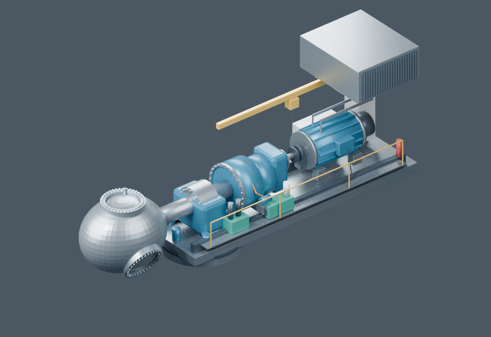

# 风机相关的材料

围绕 Vestas V90-2.0 MW 双馈风机整理的 BIM 重建代码、三维模型、网页演示、教学仿真和参考资料。模型依据公开资料重建，适合用于结构展示、系统原理说明和教学演示。

当前浏览程序为 **R15**，基础几何版本为 **R10**。



## 功能介绍

- **三维浏览**：整机与机舱视角、构件选择、属性查询、系统筛选、剖切和分解展示。
- **系统展示**：传动链、偏航、变桨、测风、电气与并网路径，以及塔筒内部结构。
- **教学仿真**：风况、转速、桨距、偏航和储能示意。
- **故障教学**：主轴承温升、齿轮箱振动、叶片变桨迟滞、偏航驱动异常的注入、告警确认与恢复条件演示。
- **事件与回放**：教学事件记录、历史回放和数据导出。
- **模型与材料下载**：GLB、IFC、Blender 源模型、构件清单、图册和参考手册。

## 快速启动

### 环境要求

- Python 3：网页服务仅使用 Python 标准库，无需安装额外 Python 包。
- 支持 WebGL 的现代桌面浏览器。
- Git：用于克隆仓库，也可从 GitHub 下载 ZIP 后解压。

浏览现有模型不需要安装 Blender、Node.js 或数据库；网页使用的 Three.js 库和模型文件已包含在仓库中。

### 克隆并运行

```bash
git clone https://github.com/zhang956/wind-turbine-materials.git
cd wind-turbine-materials/风机BIM交付
python3 start_viewer.py
```

打开 **http://127.0.0.1:8788/viewer/**，按 `Ctrl+C` 停止服务。

Windows 如未提供 `python3` 命令，可改用：

```powershell
py -3 start_viewer.py
```

### 局域网访问

```bash
python3 start_viewer.py --bind 0.0.0.0 --port 8788
```

同一局域网的设备访问 `http://服务器实际IP:8788/viewer/`，并确保服务器防火墙允许该端口。Linux/macOS 也可执行 `bash start.sh`，该脚本默认监听所有网卡的 8788 端口。

端口被占用时，可改为 `--port 8789`，浏览器地址中的端口也要同步修改。

### 离线查看

双击 [`风机BIM交付/打开三维模型.html`](风机BIM交付/打开三维模型.html) 可查看内嵌模型。若浏览器限制本地 HTML 或 WebGL，请使用上述 HTTP 启动方式。真实测点接口需要运行 Python 服务。

## 仓库目录

| 路径 | 内容 |
| --- | --- |
| `风机BIM交付/viewer/` | 三维浏览和教学仿真前端、第三方库 |
| `风机BIM交付/start_viewer.py` | 网页服务与只读测点快照接口 |
| `风机BIM交付/models/` | GLB、IFC、Blender 模型 |
| `风机BIM交付/data/` | 构件清单、映射模板、来源和版本信息 |
| `风机BIM交付/src/` | 参数建模、导出、渲染与打包脚本 |
| `风机BIM交付/docs/` | 各版本说明、实施和验收资料 |
| `风机BIM交付/tests/` | 自动化检查脚本及历史验证截图 |
| `风机BIM交付/preview/` | 模型预览与图册图片 |
| `风机BIM交付/references/` | 公开参考手册 |
| `风机BIM网页站点/dist/` | 打包后的静态网页材料 |
| `风机孪生参考资料/` | 风机参考资料 |
| `V90_双馈风机_BIM重建_R01_20261016.zip` | R01 历史交付包，当前版本以目录中的文件为准 |

## 本地配置与真实测点

仓库已包含默认展示和教学仿真所需文件。账号密码、开发工具配置、托管平台配置和缓存不参与默认启动，因此未上传。

默认**未连接真实风机或 SCADA**。真实数据接入需由外部采集器生成 JSON 快照，并通过参数指定：

```bash
python3 start_viewer.py --telemetry-file /path/outside-delivery/telemetry.json
```

快照文件必须位于 `风机BIM交付` 目录之外。数据结构、点位及接入约定请查看：

- [R14 接入说明](风机BIM交付/docs/R14使用与验收.md)
- [测点映射模板](风机BIM交付/data/测点映射模板.csv)
- [测点规则模板](风机BIM交付/data/telemetry-rules-template.json)

服务检查地址为 `/api/health`。未配置快照时，`telemetryConfigured` 为 `false`，`/api/telemetry` 返回 503，表示尚未配置数据源。

## 重新生成模型

仅查看现有成果无需执行重建。修改几何并重新导出时，需要另外准备 Blender 4.x、相应 Python 包以及 Node.js/esbuild。具体步骤见 [使用说明](风机BIM交付/使用说明.txt) 的“重建脚本运行”部分。

## 使用边界与资料来源

- 本项目基于公开资料重建，内部布置和部分尺寸为估算或示意，不是原厂 CAD、施工图或可制造设计。
- 故障、告警阈值和储能行为用于教学，不代表厂家保护定值或实际风机控制逻辑。
- IFC/GLB 基础模型不包含网页中的全部动态教学状态；Revit 等客户端的导入效果需要另行验证。
- Python 服务用于本地预览和只读快照接入，生产部署与现场接口需要进一步联调。
- 第三方参考资料版权归原作者，Three.js 许可证见 [vendor/LICENSE](风机BIM交付/viewer/vendor/LICENSE)。公开仓库不代表第三方材料可无限制再分发。

更多说明：[R15 故障教学](风机BIM交付/docs/R15故障教学使用说明.md) · [来源目录](风机BIM交付/data/source_catalog.json) · [版本清单](风机BIM交付/data/viewer-release.json)。
